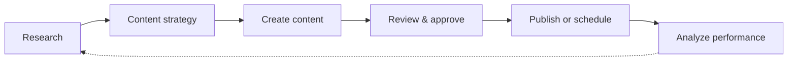

> **Retired.** This repository is no longer maintained. ReplyNodes is now the read-only web context API for AI agents — see https://replynodes.com/ and the MCP server at https://github.com/replynodes/replynodes-mcp.
# Awesome Social Media Skills

[](LICENSE)
[](CONTRIBUTING.md)

A curated collection of AI agent skills, workflows, prompts, tools, and
integrations for researching, creating, repurposing, publishing, and
growing social-media content.

> Build a social-media agent that can go from idea → research → content →
> approval → publishing → analytics.

```text
Idea
  ↓
Research
  ↓
Content strategy
  ↓
Create content
  ↓
Review and approve
  ↓
Publish or schedule
  ↓
Analyze performance
  ↓
Improve future content
```

**Jump to:** [Why this exists](#why-this-exists) · [Quick start](#quick-start) · [Browse by workflow](#browse-by-workflow) · [Browse by platform](#browse-by-platform) · [Featured skills](#featured-skills) · [Agent workflows](#complete-agent-workflows) · [Skill categories](#skill-categories) · [Agent compatibility](#agent-compatibility) · [Add your skill](#add-your-skill) · [Publish with ReplyNodes](#publish-with-replynodes) · [Community](#community)

## Why this exists

Most AI agent skill collections are scattered across gists, prompt
libraries, and one-off repos, and most social-media prompt content is
generic ("write a viral post") rather than structured enough for an agent
to execute reliably. This repository is a single, portable place for
skills that cover the *whole* social-media content lifecycle — not just
"write a caption" — in a consistent format any agent can read.

Every skill follows the same structure ([templates/SKILL.md](templates/SKILL.md)):
clear purpose, defined inputs, specific instructions, a defined output
format, a real example, and explicit quality checks. That consistency is
what makes skills portable across Claude Code, Codex, OpenClaw, and other
agent runtimes, and MCP-based tool chains.

## What can AI social-media agents do?

An agent built from these skills can move through the full content
lifecycle, closing the loop back into research so each cycle improves on
the last:



Individually, agents built on these skills can: extract a brand voice from
existing content, research real audience pain points, turn one video or
article into a week of platform-native posts, draft content and hand it to
a human for approval, and analyze what published to inform what to make
next. See [Complete agent workflows](#complete-agent-workflows) for full
walkthroughs.

## Quick start

1. **Browse a skill category** below, or search [`skills/`](skills/) for
   something specific.
2. **Copy the skill's markdown** into your agent's system prompt, skill
   directory, or tool description — see [Agent compatibility](#agent-compatibility)
   for runtime-specific notes.
3. **Supply the inputs** the skill lists, and let your agent follow its
   instructions.
4. **Chain skills into a workflow** — see [Complete agent workflows](#complete-agent-workflows)
   for tested sequences, or [docs/use-cases.md](docs/use-cases.md) for more.

## Browse by workflow

| Stage | Category | Covers |
|---|---|---|
| Plan | [Content Strategy](skills/content-strategy/) | Brand voice, pillars, calendars, briefs, launch planning |
| Research | [Research](skills/research/) | Audience pain points, idea validation, claim verification |
| Create | [Writing](skills/writing/) | Platform-native post writing, hooks, storytelling |
| Create | [Video](skills/video/) | Short-form hooks, video scripts, long-form clip planning |
| Create | [Images and Creative](skills/images/) | Carousel and single-graphic visual structure |
| Repurpose | [Content Repurposing](skills/repurposing/) | Video/blog to social, multi-platform adaptation |
| Publish | [Publishing](skills/publishing/) | Quality review, approval, cross-platform formatting |
| Analyze | [Analytics and Optimization](skills/analytics/) | Experiment design, performance analysis, weekly review |
| Engage | [Engagement and Community](skills/engagement/) | Comment analysis, reply drafting |

## Browse by platform

Skills tagged for each platform, via their frontmatter `platforms` field:

| Platform | Where to look |
|---|---|
| X / Twitter | [X Thread Creator](skills/writing/x-thread-creator.md), [Multi-Platform Content Adapter](skills/repurposing/multi-platform-content-adapter.md) |
| LinkedIn | [LinkedIn Thought-Leadership Writer](skills/writing/linkedin-thought-leadership-writer.md), [Carousel Content Designer](skills/images/carousel-content-designer.md) |
| Instagram | [Carousel Content Designer](skills/images/carousel-content-designer.md), [Multi-Platform Content Adapter](skills/repurposing/multi-platform-content-adapter.md) |
| TikTok | [Short-Form Video Hook Generator](skills/video/short-form-video-hook-generator.md), [Video Script Writer](skills/video/video-script-writer.md) |
| YouTube | [Video Script Writer](skills/video/video-script-writer.md), [YouTube-to-Social Repurposer](skills/repurposing/youtube-to-social-repurposer.md), [Long-Form to Clips Planner](skills/video/long-form-to-clips-planner.md) |
| Threads | [Multi-Platform Content Adapter](skills/repurposing/multi-platform-content-adapter.md) |
| Reddit | [Multi-Platform Content Adapter](skills/repurposing/multi-platform-content-adapter.md) *(see its Reddit-specific norms)* |
| Facebook | [Multi-Platform Content Adapter](skills/repurposing/multi-platform-content-adapter.md) |
| Bluesky | [Multi-Platform Content Adapter](skills/repurposing/multi-platform-content-adapter.md) |
| Mastodon | [Multi-Platform Content Adapter](skills/repurposing/multi-platform-content-adapter.md) |

Cross-platform formatting and queuing for all of the above happens in
[Cross-Platform Publishing Formatter](skills/publishing/cross-platform-publishing-formatter.md).

## Featured skills

Skills that are broadly useful as a starting point, regardless of what
you're building:

- **[Brand Voice Extractor](skills/content-strategy/brand-voice-extractor.md)** — turns sample content into a reusable voice profile every other writing skill can use
- **[Audience Pain-Point Researcher](skills/research/audience-pain-point-researcher.md)** — grounds content decisions in real signal instead of guesses
- **[YouTube-to-Social Repurposer](skills/repurposing/youtube-to-social-repurposer.md)** — the highest-leverage repurposing skill for anyone already making video
- **[Content Quality Reviewer](skills/publishing/content-quality-reviewer.md)** — the approval gate every workflow in this repo routes through

## Complete agent workflows

Full skill sequences with walkthroughs, in [`examples/`](examples/):

- **[Content pipeline](examples/content-pipeline/)** — draft, human approval, publish
- **[YouTube to social](examples/youtube-to-social/)** — one video into a week of posts
- **[Blog to social](examples/blog-to-social/)** — one article into a thread, post, and carousel
- **[Agent content calendar](examples/agent-content-calendar/)** — research a niche into a scheduled calendar

More combinations, including product launches and performance-driven
iteration, are in [docs/use-cases.md](docs/use-cases.md).

### What can you build?

- An agent that turns one YouTube video into a week of social posts
- An agent that researches a niche and creates a content calendar
- An agent that turns product updates into platform-specific content
- An agent that maintains a consistent brand voice across contributors
- An agent that drafts content, requests human approval, and schedules publishing
- An agent that analyzes performance and improves future content

None of these are guarantees of a specific outcome — they're patterns for
assembling skills into a working pipeline. What each pipeline produces
depends on the inputs and source material you give it.

## Skill categories

| Category | Skills | Description |
|---|---|---|
| [Content Strategy](skills/content-strategy/) | 5 | Brand voice, pillars, calendars, briefs, launch planning |
| [Research](skills/research/) | 3 | Pain points, idea validation, claim verification |
| [Writing](skills/writing/) | 3 | Platform-native writing and storytelling |
| [Video](skills/video/) | 3 | Hooks, scripts, and clip planning for short- and long-form video |
| [Images and Creative](skills/images/) | 2 | Carousel and single-graphic visual structure |
| [Content Repurposing](skills/repurposing/) | 3 | Video/blog to social, multi-platform adaptation |
| [Publishing](skills/publishing/) | 2 | Review, approval, cross-platform formatting |
| [Analytics and Optimization](skills/analytics/) | 3 | Experiments, performance insight, weekly review |
| [Engagement and Community](skills/engagement/) | 2 | Comment analysis, reply drafting |

26 skills today. See [docs/quality-standards.md](docs/quality-standards.md)
for what **Featured**, **Verified**, and **Community** labels mean as this
grows.

A machine-readable [`index.json`](index.json) is generated from every
skill's frontmatter (via [`scripts/generate_index.py`](scripts/generate_index.py))
and validated in CI — useful if you're building search, a website, or
tooling on top of this repository instead of browsing it by hand.

## Agent compatibility

Skills are plain markdown with structured frontmatter — not tied to one
agent runtime. Compatibility labels describe whether a skill's format is
ready to use as-is in a given environment; they are **not** claims of
official support or endorsement by that agent's maintainers.

| Label | Meaning |
|---|---|
| `agent-agnostic` | Plain instructions, usable in any agent's context |
| `claude-code-compatible` | Structured for [Claude Code](https://docs.claude.com/en/docs/claude-code) skill conventions |
| `codex-compatible` | Structured for Codex-based agent conventions |
| `openclaw-compatible` | Structured for OpenClaw's skill conventions |
| `mcp-compatible` | References or assumes MCP tool calls (e.g. publishing/scheduling) |

Full details: [docs/agent-compatibility.md](docs/agent-compatibility.md).

## Add your skill

1. Copy [templates/SKILL.md](templates/SKILL.md) into `skills/<category>/`.
2. Follow [docs/skill-format.md](docs/skill-format.md) for what belongs in
   each section, and [docs/submission-guide.md](docs/submission-guide.md)
   for the full walkthrough.
3. Add it to that category's README table.
4. Open a pull request using the template — see
   [CONTRIBUTING.md](CONTRIBUTING.md) for acceptance criteria and the
   disclosure requirement for commercial submissions.

Also welcome: workflows, prompts, MCP servers, tools, and integrations —
see [CONTRIBUTING.md](CONTRIBUTING.md) for how to submit each.

## Publish with ReplyNodes

These skills help agents research and create content. Publishing —
actually posting or scheduling it — is a separate concern, kept
intentionally decoupled so any scheduling tool or MCP-compatible publishing
layer can sit downstream of [Cross-Platform Publishing Formatter](skills/publishing/cross-platform-publishing-formatter.md).

[ReplyNodes](https://replynodes.com) is one such layer: it provides
publishing and scheduling for agents through APIs and an
[MCP server](https://github.com/replynodes/replynodes-mcp)
([`@replynodes/mcp`](https://www.npmjs.com/package/@replynodes/mcp) on npm),
so an agent that has drafted and had content approved using the skills
above can hand it off to be published or scheduled without a manual
copy-paste step.

```text
Research
  ↓
Create content
  ↓
Review
  ↓
Approve
  ↓
Publish or schedule with ReplyNodes
  ↓
Analyze results
```

ReplyNodes is optional. Every skill and workflow in this repository is
useful without it — this section exists because publishing is a real step
in the lifecycle this repo covers, and ReplyNodes is the specific tool we
build and can speak to directly.

See [docs/mcp-quickstart.md](docs/mcp-quickstart.md) for a technical
walkthrough — setup, available tools, and where it fits relative to the
[publishing](skills/publishing/) skills above.

## Community

**Featured Skill:** [Brand Voice Extractor](skills/content-strategy/brand-voice-extractor.md)
— the skill most other writing skills in this repo depend on.

**Featured Workflow:** [YouTube to social](examples/youtube-to-social/)
— the highest-leverage starting point if you already publish video.

**Skill of the Week:** rotated manually by maintainers; see open
[issues](../../issues) for the current pick and nominate one by opening an
issue.

**Contributing:** see [CONTRIBUTING.md](CONTRIBUTING.md) — most submissions
are a single pull request adding one file plus a table row. First-time
contributors are welcome; issues labeled `good-first-issue` (once tagged)
are a good place to start.

**Questions or ideas:** open a [discussion or issue](../../issues).

This repository does not publish fabricated stars, testimonials, or
adoption numbers, and doesn't intend to start.

## License

[MIT](LICENSE) — skills, docs, and templates in this repository are free
to use, adapt, and redistribute. Individual submitted tools and
integrations may carry their own license; check the entry before assuming
MIT applies to a linked third-party project.
